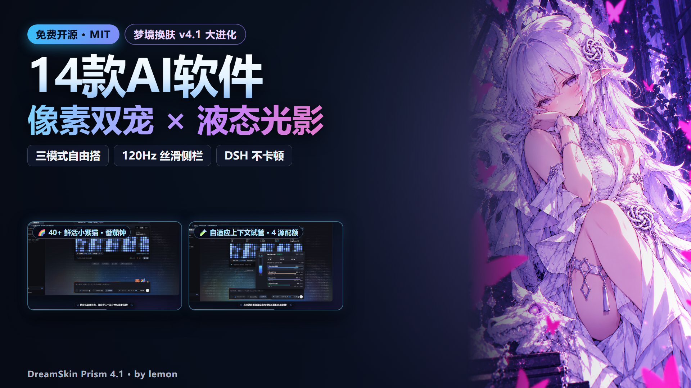
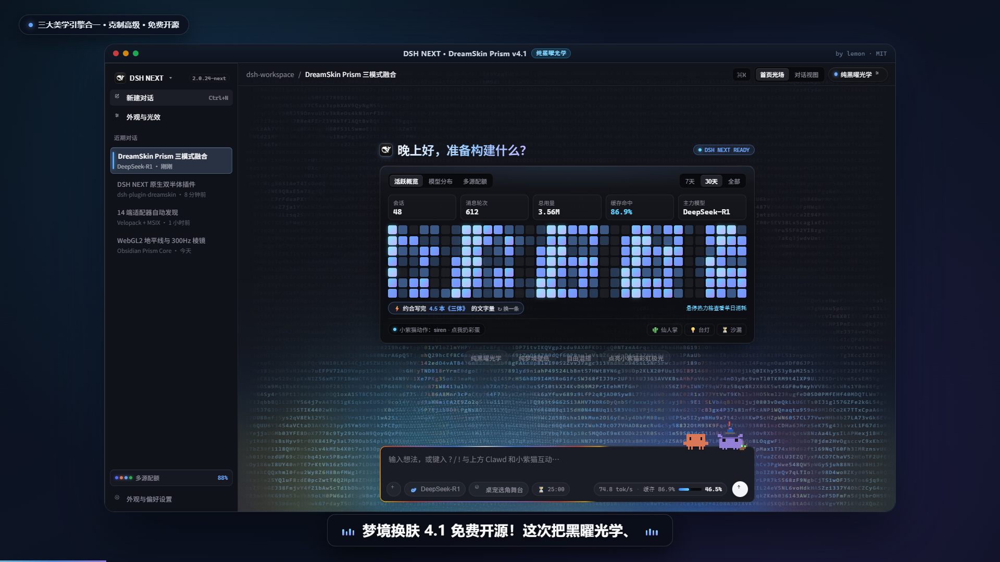
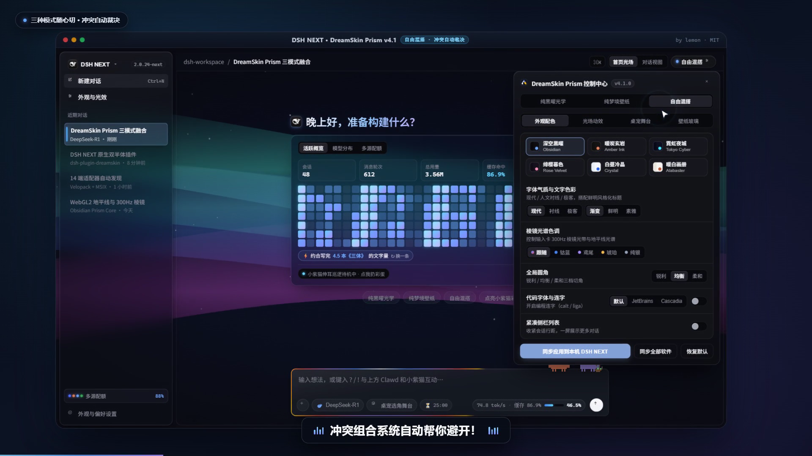
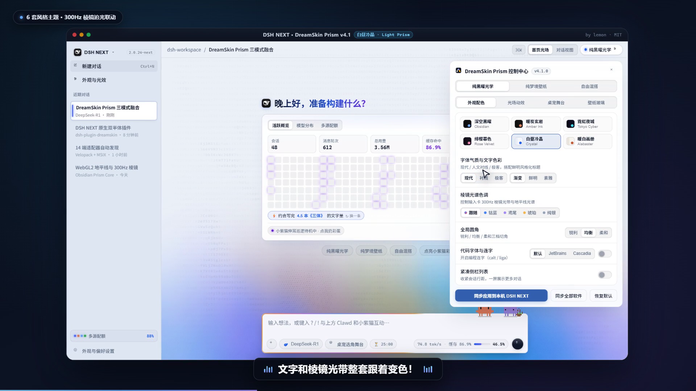
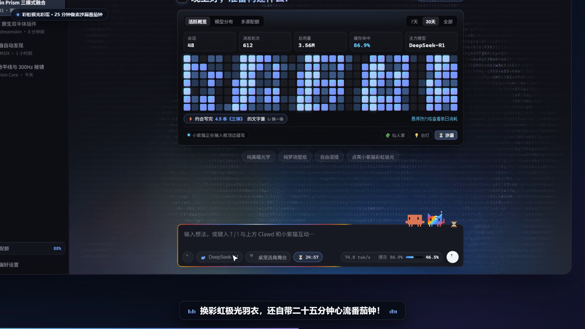
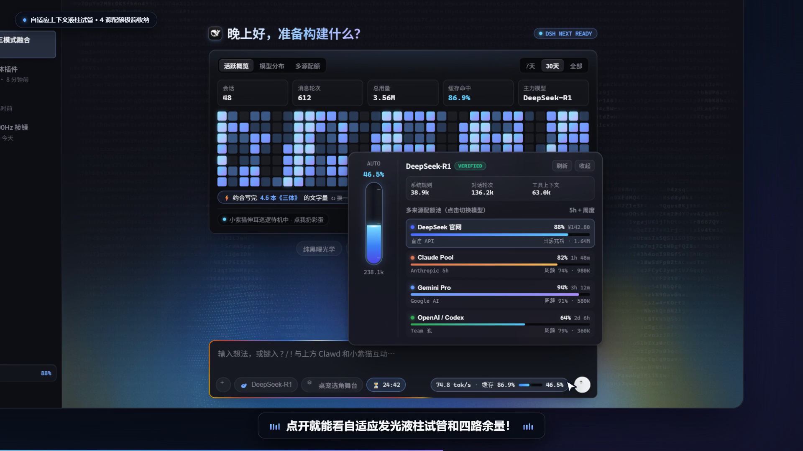

<div align="center">

<br />



<br /><br />

# DreamSkin Prism

### 光影落入界面，克制成就通透。

一套面向 **14 款主流 AI 桌面客户端** 的全平台三模式光学换肤与动态壁纸工作台。<br />
不破坏一字节官方安装包，将 **纯黑曜光学 × 鲜活像素双宠 × 液态动态壁纸** 融为一体，以克制秩序重塑桌面工具的呼吸感。

<br />

[](https://github.com/ningmengningmeng233-sys/mengjinghuanfu/releases)
&nbsp;
[](https://github.com/ningmengningmeng233-sys/mengjinghuanfu)
&nbsp;
[](LICENSE)
&nbsp;
[](#二一座工作台十四款主流-ai-客户端)
&nbsp;
[](#五克制的边界)

</div>

<br />

---

## 一、v4.1 核心进化 · 三模式自由搭配

绝大多数桌面 AI 客户端共享着沉闷的纯黑底板；而传统换肤工具往往在「花哨卡顿」与「改包失效」之间摇摆。

**DreamSkin Prism v4.1** 带来统一的三模式裁决引擎——让用户自由搭配，并由系统自动规避视觉与性能冲突：

- **◆ 纯黑曜光学（Optical）** — WebGL2 字符矩阵波纹 + 地平线棱镜光幕 + 300Hz 虹彩追光边框 + 鲜活像素双宠；自动关闭壁纸与毛玻璃，极致省电锐利。
- **✦ 纯梦境壁纸（Wallpaper）** — 动静态图片 / MP4 视频 / Steam 创意工坊壁纸 + 6 层液态亚克力毛玻璃 + `0–24px` 连续清晰度调节（0px 水晶超清原画）。
- **❖ 自由混搭（Hybrid）** — 开放 6 项独立模块自由拼装；冲突组合（如未开壁纸却开毛玻璃、或毛玻璃叠加全屏动态画布拖慢显卡）由系统自动裁决降级，绝不把界面调卡调崩。

<br />

<div align="center">
  
  <p><sub>纯黑曜光学首页光场 · WebGL2 字符矩阵 × 300Hz 棱镜追光 × Clawd 与小紫猫</sub></p>
</div>

<br />

<div align="center">
  
  &nbsp;
  
  <p><sub>左：自由混搭 · 动态极光壁纸与液态玻璃 &nbsp;·&nbsp; 右：一键切换白昼冷晶浅色光学</sub></p>
</div>

<br />

<div align="center">
  
  &nbsp;
  
  <p><sub>左：小紫猫彩虹极光羽衣 × 像素沙漏 25 分钟番茄钟 &nbsp;·&nbsp; 右：自适应上下文发光试管 × 4 源配额浮窗</sub></p>
</div>

<br />

---

## 二、一座工作台，十四款主流 AI 客户端

按新版真实界面结构逐端实测对齐，调好一套配色即可一键同步全平台，并自动礼让 Antigravity 原生插件和平共存：

| 客户端 | 适配亮点 |
| :--- | :--- |
| **DSH NEXT (`2.0.24 ~ 2.0.28`)** | 原生双半体插件（`dsh-plugin-dreamskin`）免重启热切换 · 打通官方 **45+ `--dsw-*` 插件变量** 与其他插件天生合拍 · **5 项防卡顿瘦身**省掉 60%+ GPU 像素开销 |
| **Antigravity（反重力）** | Hub + IDE 双壳支持 · 内置浏览器圆角避让挖洞 · 原生右侧边栏面板 · 与 `obsidian-prism` 自动和平共存 |
| **ZCode (`4.0.0+`)** | 适配新版 v4 时间线消息层、气泡与输入卡结构 · 原版高清图标 |
| **Codex 桌面版 (`26.1117+`)** | 适配新版 `data-composer-surface-variant` 与 Windows MSIX 通道 |
| **Cherry Studio (`2.1 / 2.2+`)** | 适配新版 Agent 模式主区与悬浮胶囊输入栏 · 语义部件自动降级保护 |
| **MiniMax Code / MiniMax Design** | 代码区高对比护眼底板 · 浮岛玻璃与双宠防裁切 |
| **OpenCode / WorkBuddy / Qoder IDE / T3 Code** | 补齐侧栏激活光条、消息区与输入卡定位 · 真实客户端版本自动识别 |
| **VS Code / Windsurf / Kiro** | 统一 VS Code 系聊天与编辑器语义适配 |

---

## 三、克制高级的细节与鲜活交互

- **真正“活过来”的像素双宠（40+ 动作）** — 完整还原 Clawd × 小紫猫像素细节与待机剧场（舔爪、啃鱼干、追激光点、点背景抖耳扭头、四宠叠叠乐与隐藏「彩虹极光羽衣」），搭配实时心情气泡、角隅像素摆件（仙人掌 / 台灯 / 沙漏）与 **25 分钟心流番茄钟**。
- **6 套高协调风格主题 + 字体与字色自选** — 深空黑曜、暖炭玄岩、霓虹夜城（Tokyo Cyber）、绯樱暮色（Rose Velvet）、白昼冷晶、暖白画册；标题、热力图、进度条、自适应上下文试管液柱与棱镜边光整套统一联动。
- **120Hz 磁吸侧栏 & 极简收纳** — 左侧任务栏升级为纯 GPU 悬浮磁吸滑轨 + 跟手微光；多源配额收进侧栏单行胶囊与输入框进度条，点击才展开 **自适应上下文发光液柱试管 + 4 源配额浮窗**。
- **高效直觉快捷键** — `Ctrl + K` 全局命令面板、`Ctrl + Shift + Z` Zen 沉浸专注模式、`Ctrl + Alt + W` 快捷调节浮窗、连按 4 次 `Esc` 当场秒撤还原。
- **全形态壁纸生态** — 内置 8 套 60fps 零依赖互动动态主题、Steam 创意工坊（`431960`）直连、本地 MP4 / 图片拖拽与经典在线主题库，切后台自动省电定格。

---

## 四、极简上手与本地部署

### 1. 直接部署到本机 Antigravity & DSH NEXT（Node.js 22+）
```powershell
git clone https://github.com/ningmengningmeng233-sys/mengjinghuanfu.git
cd mengjinghuanfu
node scripts/build-studio-ui.mjs    # 构建侧边栏控制工作台
node scripts/deploy-local.mjs       # 一键同步部署到 Antigravity 插件 + DSH NEXT 原生插件
node scripts/dsh-live-preview-server.mjs  # 可选：在浏览器实时预览全套 v4.1 交互光效
```

### 2. 运行全量回归测试
```powershell
node --test "tests/*.test.mjs"
```

### 3. 桌面发行版与交流群
- 独立桌面安装包请前往 [Releases](https://github.com/ningmengningmeng233-sys/mengjinghuanfu/releases) 下载。
- 欢迎加入 **lemon 的养鱼粉丝群（QQ：`1130179263`）** 分享壁纸搭配、领取视频同款极光壁纸或反馈想适配的新软件！

---

## 五、克制的边界

- **零修改安装包** — 绝不改动任何客户端的 `app.asar`、数字签名或账户数据，软件升级不失效。
- **多插件和平共生** — 自动识别并礼让同类外观插件；DSH 端绝不遮挡配额面板、审批卡与侧边抽屉。
- **零隐私采集** — 不读取任何聊天文本、代码内容或 Cookie；配置仅保存在本地 `%LOCALAPPDATA%\DreamSkin`。

---

## 六、特别致谢

本项目基于 [MIT License](LICENSE) 开源，衷心感谢以下优秀开源项目的授权、架构与美学启发（完整声明见 [THIRD-PARTY-NOTICES.md](THIRD-PARTY-NOTICES.md)）：

- **[`azwosile/agy-wallpaper-prism`](https://github.com/azwosile/agy-wallpaper-prism)** *(MIT)* — 特别致谢原作者的开源授权与 6 层液态玻璃光学体系、Steam 创意工坊动态壁纸引擎及内置浏览器避让挖洞设计。
- **[`RMvdesi/obsidian-prism`](https://github.com/RMvdesi/obsidian-prism)** — 黑曜光学语言、WebGL2 地平线光场、300Hz 棱镜光带与像素桌宠互动体验灵感。
- **[`Fei-Away/Codex-Dream-Skin`](https://github.com/Fei-Away/Codex-Dream-Skin)** *(MIT)* · **[`boilcy/CherryCSS`](https://github.com/boilcy/CherryCSS)** *(MIT)* · **[`tinted-theming/schemes`](https://github.com/tinted-theming/schemes)** *(MIT)*。

---

<div align="center">

<br />

*愿每一次打开屏幕，都像推开一扇通透的窗。*

Crafted by **lemon** · 如果 **DreamSkin Prism** 曾让你的桌面变得更顺眼一点，欢迎点一颗 ⭐ **Star**。

</div>
