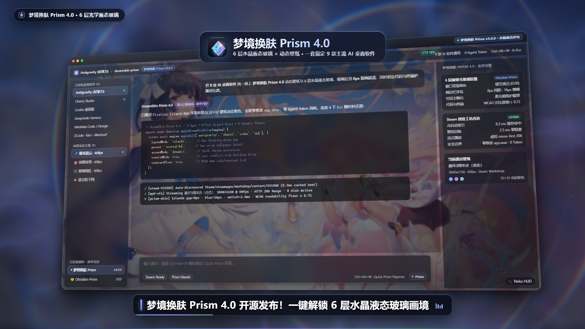
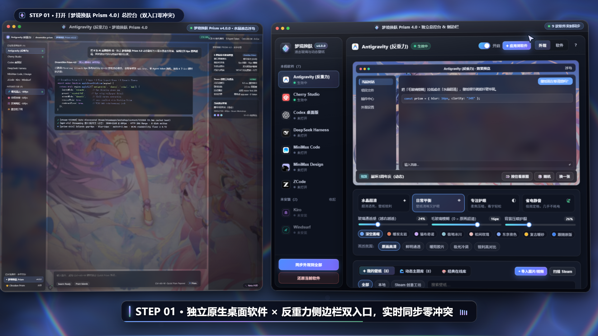
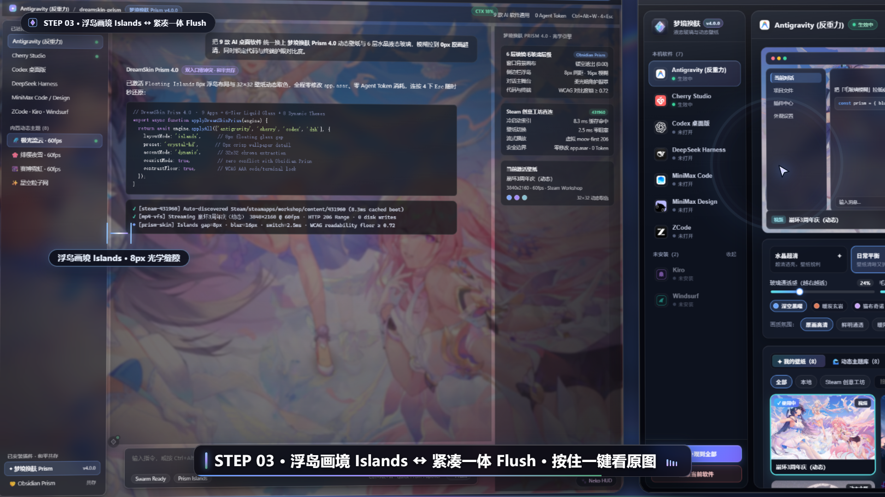

<div align="center">

<br />



<br /><br />

# DreamSkin Prism

### 光影落入界面，克制成就通透。

一套面向 **9 款主流 AI 桌面客户端** 的极简液态玻璃与动态壁纸工作台。<br />
不破坏一字节官方安装包，以 6 层光学毛玻璃与 8px 浮岛留白，重塑桌面工具的秩序与呼吸感。

<br />

[](https://github.com/ningmengningmeng233-sys/dreamskin-prism/releases)
&nbsp;
[](LICENSE)
&nbsp;
[](#克制的边界)
&nbsp;
[](README.en.md)

</div>

<br />

---

## 一、设计哲学 · Minimalism & Optics

绝大多数桌面 AI 客户端共享着同一种沉闷的纯黑底板。换肤工具常走向另一个极端——花哨堆砌、遮挡文字、修改安装包导致更新失效。

**DreamSkin Prism 4.0** 选择第三条路：**以光学层次取代装饰堆砌，以克制留白服务日常专注。**

- **六层液态玻璃层次** — 从镂空透出壁纸的底层舞台、8px 呼吸缝隙的侧边浮岛，到柔光护眼的对话主舞台与锁定 WCAG AAA 可读性底限的代码/终端区，每一层玻璃都拥有独立通透度与折射边界。
- **0px 水晶超清哲学** — 毛玻璃模糊支持 `0–24px` 连续微调。拉至 `0px` 并开启「水晶超清」预设，原画壁纸的每一笔笔触与星光纤毫毕现，正文与代码依然清晰锐利。
- **昼夜双境，动态取色** — 内置深空黑曜、暖炭玄岩、极地冰川 Nord 白昼浅霜等 **8 组明暗配色** 与 **5 种画质氛围滤镜**，自动从当前壁纸提取 32×32 色度主色，让界面与画面浑然一体。

<br />

<div align="center">
  
  <p><sub>原生深空暗色独立总控台 · 自动识别 7 款本机软件原版图标 · 16:10 所见即所得实时预览</sub></p>
</div>

<br />

<div align="center">
  
  &nbsp;
  
  <p><sub>左：Floating Islands 8px 浮岛呼吸缝隙 &nbsp;·&nbsp; 右：一键切换极地冰川 Nord 白昼浅霜</sub></p>
</div>

<br />

---

## 二、一座工作台，九款主流 AI 客户端

统一的美学语言，跨软件自由独立定制或一键同步配色。

| 客户端 | 适配状态 | 设计与工程细节 |
| :--- | :---: | :--- |
| **Antigravity（反重力）** | 一等公民 | Hub + IDE 双壳支持 · `2.34.0` 内置浏览器圆角避让挖洞 · 原生右侧边栏插件 · 与 `obsidian-prism` 一键和平共存 |
| **Cherry Studio** | 完整支持 | 多视图原生液态玻璃 · 语义部件体检与版本更新自动降级保护 |
| **Codex 桌面版** | 完整支持 | Windows MSIX 通道无损接入 · 原版高清图标自动提取 |
| **DeepSeek Harness** | 完整支持 | 全工作区护眼毛玻璃 · 显式确认（Consent）可选插件通道 |
| **MiniMax Code** | 完整支持 | 代码区高对比护眼底板 · 浮岛玻璃层次 |
| **MiniMax Design** | 完整支持 | 设计工作台动态壁纸背景与柔焦层次 |
| **ZCode** | 完整支持 | 一键换肤与跨软件配色壁纸同步 |
| **Windsurf / Kiro** | 骨架支持 | 保留 VS Code 系骨架适配器，持续跟进实测 |

---

## 三、全形态壁纸与零依赖动效

无需折腾格式，静态美图、流动光影与创意工坊统一收纳。

- **8 套内置 60fps 互动动态主题** — 极光流云、绯樱夜雪、赛博霓虹网格、星空粒子网、深海光斑、霓虹雨夜、矩阵代码雨、星云涡旋。零外网依赖、开箱即动；窗口切至后台时自动省电定格。
- **Steam 创意工坊直连（431960）** — 8.3ms 缓存冷启动自动发现本机 Wallpaper Engine 壁纸库，原生支持图片、视频、HTML 交互网页与 PKGV/LZ4 `scene.pkg` 场景。
- **2.5ms 零拷贝秒切** — 虚拟 MP4 Faststart 与 HTTP 206 Range 流式播放，切壁纸顺滑无闪黑；支持拖拽本地 MP4、粘贴网络直链与经典在线主题库（`dreamskin.cc`）。
- **按住一键看原图** — 在预览区长按即可瞬间隐去全部 UI 玻璃层，纯粹欣赏完整原画。

---

## 四、极简上手

### 1. 独立原生桌面软件（Windows）
前往 [Releases](https://github.com/ningmengningmeng233-sys/dreamskin-prism/releases) 下载 `梦境换肤-Windows-4.0.0.zip`，解压后直接双击 **`梦境换肤-4.0.0-Windows.exe`**。内置独立运行环境，无需安装 Node.js，开启系统托盘静默守护。

### 2. 反重力（Antigravity）原生侧边栏
将仓库中的 `plugin/` 安装至 `~/.gemini/config/plugins/dreamskin-prism`，即可直接在反重力右侧边栏呼出控制面板。双入口共享同一本地后台与配置，实时同步，**0 Agent Token 消耗**。

### 3. 日常直觉快捷键
- **`Ctrl + Alt + W`** — 在任意已换肤软件内呼出极简快捷调节浮窗，随手切壁纸或微调通透度。
- **连按 4 次 `Esc`** — 随时当场秒撤全部皮肤层，瞬间回到软件出厂原貌。

> 开源免费版暂未购买商业代码签名证书。Windows 首次运行如出现 SmartScreen 提示，确认来源为本官方仓库后，点击 **「更多信息」→「仍要运行」** 即可。

---

## 五、克制的边界

我们相信优雅的工具应当让人毫无心理负担：

- **零修改安装包** — 绝不改动目标应用的 `app.asar`、数字签名或账户数据，软件更新不受任何影响。
- **一键和平共存** — 若已安装 `obsidian-prism` 等同类外观插件，开启「和平共存」即可各司其职、互不冲突。
- **零隐私采集** — 不读取任何对话文本、代码内容或 Cookie；所有本地配置集中保存在 `%LOCALAPPDATA%\DreamSkin`，随时可彻底清空。
- **老版本无损迁移** — 自动只读导入 DreamSkin v3.0.x 本地壁纸与自定义皮肤，原数据分毫不伤。

---

## 六、从源码构建

```powershell
powershell -ExecutionPolicy Bypass -File tools/fetch-node-runtime.ps1   # 首次拉取便携 Node 运行时
node tools/build-payload.mjs                                            # 构建内嵌 payload
powershell -ExecutionPolicy Bypass -File tools/build-launcher.ps1       # 编译原生 WebView2 单文件 exe
node tools/check-version.mjs                                            # 版本一致性校验
node --test "tests/*.test.mjs"                                          # 294 项全量自动化测试
```

> **关于 macOS**：核心引擎与双架构打包脚本均按跨平台架构实现，但作者暂缺 Mac 真机实测环境，当前 macOS 端标注为代码层适配，欢迎拥有 Mac 设备的开发者实测并提交 PR。

---

## 七、特别致谢

本项目基于 [MIT License](LICENSE) 开源，衷心感谢以下优秀开源项目的授权、架构与美学启发（完整声明见 [THIRD-PARTY-NOTICES.md](THIRD-PARTY-NOTICES.md)）：

- **[`azwosile/agy-wallpaper-prism`](https://github.com/azwosile/agy-wallpaper-prism)** *(MIT)* — 特别致谢原作者的开源授权与卓越的 Obsidian Prism 6 层液态玻璃光学体系、Steam 创意工坊动态壁纸引擎、温和 Fail-Open 桥接及内置浏览器避让挖洞设计。
- **[`Fei-Away/Codex-Dream-Skin`](https://github.com/Fei-Away/Codex-Dream-Skin)** *(MIT)* — 早期多软件注入器与社区主题站设计参考。
- **[`boilcy/CherryCSS`](https://github.com/boilcy/CherryCSS)** *(MIT)* · **[`tinted-theming/schemes`](https://github.com/tinted-theming/schemes)** *(MIT)* · **[`material-foundation/material-color-utilities`](https://github.com/material-foundation/material-color-utilities)** *(Apache-2.0)*。

---

<div align="center">

<br />

*愿每一次打开屏幕，都像推开一扇通透的窗。*

如果 **DreamSkin Prism** 曾让你的桌面变得更顺眼一点，欢迎点一颗 ⭐ **Star**。

</div>
