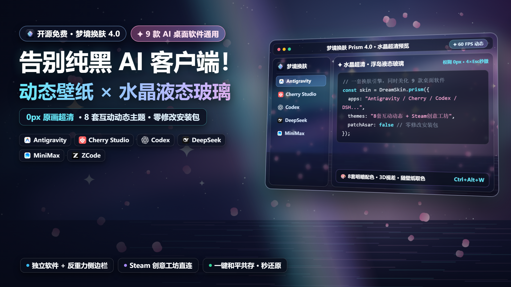
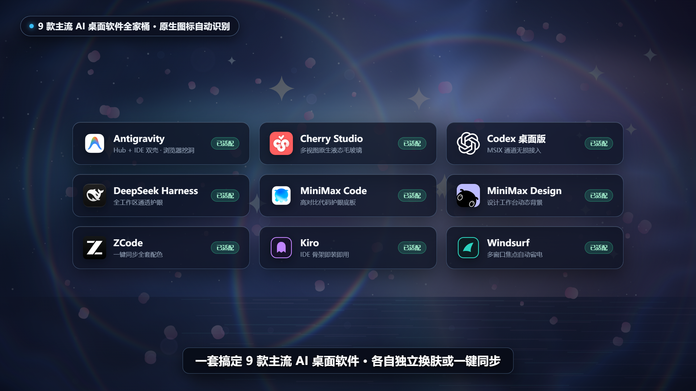
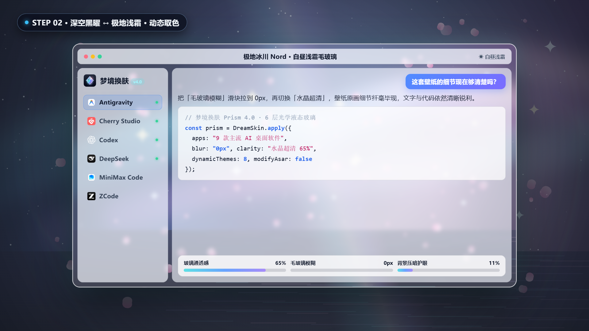

<div align="center">



# 梦境换肤 · DreamSkin Prism 4.0

**一套搞定 9 款主流 AI 桌面软件的动态壁纸与 6 层水晶液态玻璃换肤工作台**

[](#)
[](LICENSE)
[](#支持的应用共-9-款)
[](#安全与零侵入承诺)

[核心亮点](#-核心亮点) · [支持软件](#-支持的应用共-9-款) · [快速上手](#-快速开始小白-1-分钟上手) · [双入口说明](#-双入口形态) · [安全承诺](#-安全与零侵入承诺) · [特别致谢](#-特别致谢) · [English](README.en.md)

</div>

---

## ✨ 为什么做 DreamSkin Prism 4.0？

每天对着黑漆漆的 AI 客户端写代码、聊对话，是不是早看腻了？

**梦境换肤 Prism 4.0** 是一套完全免费、无侵入的桌面换肤与动态壁纸工作台：
- **不改任何安装包（零修改 `app.asar`）**，所有软件保持官方原版签名与正常升级；
- **自带单文件原生桌面软件**，同时支持作为**反重力（Antigravity）原生右侧边栏插件**运行，双入口共用同一套本地后台与配置，零冲突、零 Token 消耗；
- 全面吸收 [`azwosile/agy-wallpaper-prism`](https://github.com/azwosile/agy-wallpaper-prism)（MIT）的 6 层光学液态玻璃与动态壁纸引擎，并横向扩展到 **9 款主流 AI 桌面软件**。

---

## 🎯 核心亮点

| 能力 | 详细特性 |
| :--- | :--- |
| **🔮 6 层光学液态玻璃** | 毛玻璃模糊 **0–24px** 自由调节，内置**「水晶超清」**预设（0px 原画锐利清晰、文字依然护眼）、**8 套明暗配色**（含深空黑曜与极地浅霜白昼模式）、**5 种画质氛围滤镜**、壁纸动态取色（Material You）与**按住一键看原图**。 |
| **🌌 8 套内置 60fps 互动动态主题** | 零外网依赖、开箱即用：极光流云、绯樱夜雪、赛博霓虹网格、星空粒子网、深海光斑、霓虹雨夜、矩阵代码雨、星云涡旋；支持鼠标微互动，软件切到后台时自动省电定格。 |
| **🎬 全格式壁纸生态** | 支持本地高清图、幻灯片轮播、**MP4 / WebM 视频壁纸**（虚拟 faststart 秒开）、HTML 动态网页、**直连 Steam Wallpaper Engine（431960）创意工坊 `scene.pkg`**、网络图片/视频直链下载，并完整保留经典在线主题库（`dreamskin.cc`）。 |
| **🖥️ 16:10 高清宽屏实时预览** | 总控台内置大屏实时预览舞台，自动提取并显示本机已安装 7 款软件的原版高清图标，拖滑块所见即所得。 |
| **🤝 一键和平共存 + 秒撤兜底** | 检测到已装 `obsidian-prism` 等其他外观插件时可一键开启「和平共存」，各管各的互不打架；在任意已换肤软件内按 **`Ctrl + Alt + W`** 呼出快捷调节浮窗，连按 **4 次 `Esc`** 当场秒撤皮肤恢复原貌。 |

<p align="center">
  
  
</p>

---

## 🧩 支持的应用（共 9 款）

应用支持以独立适配器提供（`src/adapters/<id>/`），详细版本与端口矩阵见 [支持矩阵](docs/support-matrix.md)：

| 应用 | 状态 | 适配亮点 |
| :--- | :---: | :--- |
| **Antigravity（反重力）** | ✅ 一等公民 | Hub + IDE 双壳支持、`2.34.0` `[data-browser-hole]` 内置浏览器精准挖洞、原图标一键开启、原生侧边栏插件、`obsidian-prism` 和平共存 |
| **Cherry Studio** | ✅ 完整支持 | 多视图原生 6 层液态玻璃 + 动态壁纸，保留语义部件体检与更新降级保护 |
| **Codex 桌面版** | ✅ 完整支持 | Windows MSIX 通道无损接入 + 原版高清图标提取 |
| **DeepSeek Harness (DSH)** | ✅ 完整支持 | 全工作区通透护眼，可选显式确认（Consent）插件通道 |
| **MiniMax Code** | ✅ 完整支持 | 高对比代码护眼底板 + 液态玻璃 |
| **MiniMax Design** | ✅ 完整支持 | 设计工作台动态壁纸与毛玻璃 |
| **ZCode** | ✅ 完整支持 | 一键换肤与跨软件配色同步 |
| **Windsurf / Kiro** | 🧪 骨架支持 | 保留 VS Code 系骨架适配器（待真机持续完善） |

> **说明**：所有软件均支持**各自独立配置**或**一键同步皮肤配色**；老版本（v3.0.x）的本地壁纸与自定义皮肤会自动无损迁移至 4.0。

---

## 🚀 快速开始（小白 1 分钟上手）

### 方式一：独立原生桌面软件（推荐）
1. 前往 [Releases](../../releases) 下载最新 Windows 包（`梦境换肤-Windows-4.0.0.zip`），解压后直接双击 **`梦境换肤-4.0.0-Windows.exe`**（内置独立运行环境，无需装 Node.js）。
2. 在左侧选择你想换肤的软件（如 Antigravity / Cherry Studio / Codex 等）。
3. 挑一张本地美图 / MP4 视频 / Steam 创意工坊壁纸，或直接点「内置动态主题」里的 8 套现成动效，拖滑块调到顺眼，点击**「应用皮肤」**即可生效！
4. 随时可以在对应软件里按 `Ctrl + Alt + W` 微调，或连按 4 下 `Esc` 一键恢复原版。

### 方式二：反重力（Antigravity）原生侧边栏插件
- 仓库 `plugin/` 目录即为标准反重力插件包（`dreamskin-prism`），安装至 `~/.gemini/config/plugins/dreamskin-prism` 后即可在反重力右侧边栏直接打开控制面板。
- 与独立桌面软件共用同一后台端口与数据目录（`%LOCALAPPDATA%\DreamSkin`），两边操作实时同步、零冲突、**不消耗任何 Agent Token**。

> **关于 Windows SmartScreen 首次运行提示**：开源免费版本暂未购买商业代码签名证书，首次双击 `.exe` 时系统可能提示「Windows 已保护你的电脑」。确认下载自本官方仓库后，点击**「更多信息」→「仍要运行」**即可，或者按下方「从源码构建」自行编译。

---

## 🛡️ 安全与零侵入承诺

- **零修改安装包**：绝不修改目标应用的安装目录、`app.asar`、数字签名或账号配置；换肤通过本机回环（`127.0.0.1`）调试通道注入样式与独立背景层实现。
- **零隐私采集**：不读取任何聊天记录、代码内容、Cookie 或 `localStorage`；注入层不向外发送任何网络请求。
- **一键干净还原**：点击「还原为默认」或软件内连按 4 次 `Esc` 立即撤除所有注入节点并恢复普通启动，不留残余。
- **透明可控**：本地所有数据均保存在 `%LOCALAPPDATA%\DreamSkin`（macOS 为 `~/Library/Application Support/DreamSkin`），随时可查看或清空。

---

## 💻 命令行用法与从源码构建

开发或极客用户可直接通过 Node.js 22+ 命令行调用：

```powershell
node src/dreamskin.mjs apps-status                      # 查看全部 9 款应用状态
node src/dreamskin.mjs apply    --app antigravity       # 给指定应用上皮肤
node src/dreamskin.mjs check    --app cherry            # 部件命中与冲突体检
node src/dreamskin.mjs restore  --app cherry            # 一键干净还原
node src/dreamskin.mjs sync --app antigravity --to cherry  # 跨应用同步配色与壁纸
```

### 从源码自行打包 Windows 单文件软件

```powershell
powershell -ExecutionPolicy Bypass -File tools/fetch-node-runtime.ps1   # 首次：拉取便携 Node 运行时
node tools/build-payload.mjs                                            # 构建内嵌 payload
powershell -ExecutionPolicy Bypass -File tools/build-launcher.ps1       # 编译原生 WebView2 暗色窗体 exe
node tools/check-version.mjs                                            # 版本一致性校验
node --test "tests/*.test.mjs"                                          # 运行 294 项全量单元测试
```

> **关于 macOS 支持的诚实说明**：架构与核心引擎均按跨平台设计，已提供 macOS 打包脚本与内置双架构 Node 运行时的 zip 产物，但由于作者手边暂缺真机 Mac，**macOS 端目前属于代码层适配（未在真机实测）**，欢迎有 Mac 的小伙伴测试并提交 PR！

---

## 🙏 特别致谢

本项目基于 [MIT License](LICENSE) 开源，核心能力与灵感离不开以下优秀开源项目（完整声明与协议见 [THIRD-PARTY-NOTICES.md](THIRD-PARTY-NOTICES.md)）：

- **[`azwosile/agy-wallpaper-prism`](https://github.com/azwosile/agy-wallpaper-prism)**（MIT）—— 特别感谢原作者开源授权与惊艳的 Obsidian Prism 6 层液态玻璃光学架构、Steam 创意工坊动态壁纸引擎、Fail-Open 温和注入桥与内置浏览器 `[data-browser-hole]` 避让挖洞方案！
- **[`Fei-Away/Codex-Dream-Skin`](https://github.com/Fei-Away/Codex-Dream-Skin)**（MIT）—— 早期多软件 CDP 注入器与社区主题库设计参考。
- **[`boilcy/CherryCSS`](https://github.com/boilcy/CherryCSS)**（MIT）、**[`tinted-theming/schemes`](https://github.com/tinted-theming/schemes)**（MIT）、**[`material-foundation/material-color-utilities`](https://github.com/material-foundation/material-color-utilities)**（Apache-2.0）。

---

<div align="center">

如果 **梦境换肤 Prism 4.0** 让你的桌面更好看了，欢迎点一颗免费的 ⭐ **Star** 支持一下！

</div>
