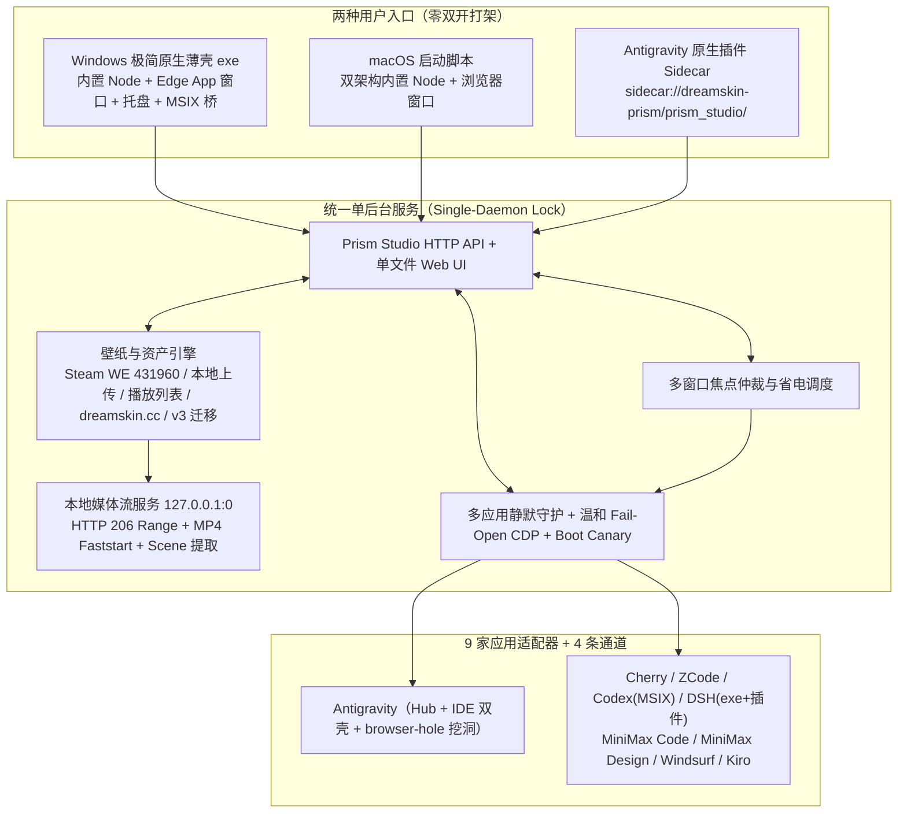

# 梦境换肤 4.0（DreamSkin Prism）全量重构与 Antigravity 适配设计方案

- **日期**：2026-11-23
- **分支**：`feat/v4-prism-upgrade`（基于 `v3.0.5` / `b0f7c36`）
- **目标版本**：`v4.0.0`
- **参考与复用声明**：经原作者授权，全面引入并融合 `azwosile/agy-wallpaper-prism`（v2.0.0，MIT）的 Obsidian Prism 液态玻璃皮肤、动态壁纸引擎、温和 Fail-Open CDP 桥与 Studio UI，保留完整第三方署名于 `THIRD-PARTY-NOTICES.md`。

---

## 1. 背景、目标与硬约束

### 1.1 背景与升级动因
现有 **梦境换肤 v3.0.5** 已具备成熟的多应用适配器架构（Cherry Studio、ZCode、Codex、DSH Desktop、MiniMax Code/Design、Windsurf/Kiro 骨架）、4 条通道（`exe` / `msix` / `webview2` / `dsh-plugin`）、部件体检自动降级与双平台内置 Node 打包能力；但在视觉与媒体层仍停留在「静态图片 + 纯色 CSS + WinForms 桌面表单」，且尚未适配 **Google Antigravity（反重力）**。

`agy-wallpaper-prism v2.0.0` 已在 Antigravity 上验证了高完成度的液态玻璃光学系统、全媒体动态壁纸（视频 / 幻灯片 / 网页 / Steam Wallpaper Engine `scene.pkg`）、温和无侵入 CDP 注入与现代化 Web 控制端，但仅面向单一宿主、设置偏极客，且缺少多应用管理与焦点省电调度。

### 1.2 核心目标
1. **底座全量升级**：以 Prism 媒体引擎 + Obsidian Prism 6 层液态玻璃内核重构梦境换肤底层，让所有已适配的桌面应用一次性获得动态壁纸、浮岛毛玻璃、动态取色与应用内快捷浮窗。
2. **体验彻底重做**：面向非专业普通用户，解决原两套设计中的 7 大真实体验痛点（见第 2 节）。
3. **Antigravity 一等公民适配**：新增 `antigravity` 适配器与原生插件/Sidecar 形态，完整支持 Antigravity `2.34.0` 双壳与 `[data-browser-hole]` GPU 挖洞，并与本机已安装的 `obsidian-prism` 做冲突检测与友好提示。
4. **资产平滑承接**：保留 `dreamskin.cc` 在线社区主题库，只读迁移本机 3.0 存量壁纸与皮肤存档，兼容导入旧 `.dsskin` 包。

### 1.3 不可违背的红线约束
- **零第三方运行时依赖**：生产运行时仅依赖 Node.js 22+ 标准库与 Windows 内置 .NET Framework 4.8（用于极简原生薄壳）。
- **零官方文件篡改**：绝不修改任何目标应用的 `app.asar`、安装目录、签名或 `~/.gemini/config/config.json`。
- **工作区边界**：所有开发与测试产物严格留在 `06-梦境换肤/` 内部；仅在终验全绿后按授权执行 Antigravity 插件拷贝安装（`~/.gemini/config/plugins/dreamskin-prism/`），不强行覆盖桌面既有 `梦境换肤-3.0.5-Windows.exe`。
- **一键可逆**：任何注入均支持瞬时无残留撤回（CLI / UI 还原、应用内 `4× Esc` 或 `Ctrl+Alt+Shift+R` 急救剥离），原桌面快捷方式升级必有 `shortcut-backup.json` 无损备份。

---

## 2. 用户体验 7 大核心优化（针对原设计的实证修补）

| # | 原设计问题 | 4.0 优化设计 | 验收判据 |
|---|---|---|---|
| 1 | Prism 参数过于极客，滑块密密麻麻 | **双层 UI**：首页仅呈现「选软件 + 选壁纸 + 4 场景大卡（通透浮岛 / 日常平衡 / 专注护眼 / 省电静音）+ 2 大白话滑块（透明度 / 背景压暗）」；所有光学、圆角、轮播、端口等细节收入「高级微调」折叠抽屉 | 默认首屏可见滑块 ≤ 2 个，高级参数默认折叠 |
| 2 | 必须靠专用快捷方式启动，软件开着要强行重启 | **原图标无损升级**：将 `.lnk` 原地追加 `--remote-debugging-port` 与 `shortcut-backup.json` 备份还原泛化至 Antigravity 及全部 `exe` 通道应用，不打断当前对话 | 快捷方式单测覆盖打补丁、幂等、无损还原；MSIX（Codex）保留清晰托管入口 |
| 3 | 多应用同播动态视频吃爆 GPU/CPU | **多窗口智能焦点冻结**：后台焦点仲裁器实时跟踪前台窗口，同一时刻至多 1 个活跃窗口播放视频/Web 壁纸，失焦/最小化/电池模式自动定格暂停 | 模拟 3 窗口并发，仅焦点窗口 `paused=false`，其余均为 `paused=true` |
| 4 | 多应用配置互相覆盖、难以区分 | **全局默认 + 单应用独立覆写 + 一键同步**：每款应用独立保存壁纸与明暗/通透参数；提供「同步到全部软件」按钮 | 切换应用参数互不污染；一键同步后全选目标一致 |
| 5 | 独立桌面端与反重力 Sidecar 同时开会分裂脑打架 | **单后台引擎仲裁（Single-Daemon Lock）**：共用 `daemon.lock.json` 与同一端口/数据目录，后启动入口自动复用已存活后台，绝不双开、绝不还原后自动回弹 | 连续启动两实例仅存活 1 个守护进程；restore 后 10s 内零自动重注 |
| 6 | 打开面板卡顿几十秒、DSH 等慢应用冷启报错超时 | **秒开缓存 + 后台静默守护**：控制端优先展示磁盘缓存状态并异步刷新；守护进程持续轮询慢启动应用，就绪即静默上肤，不阻断 UI 也不误报超时 | 控制端首屏渲染 < 500ms；慢启模拟 10s 后自动补注成功 |
| 7 | 怕糊字、怕挡反重力网页、怕和已有美化插件打架 | **四重安全兜底**：① 代码/输入框/弹窗对比度底线；② `[data-browser-hole]` 同步圆角 GPU 挖洞；③ 冲突检测内置 `obsidian-prism` 与 `codex-dream-skin` 大白话提醒；④ `4× Esc` / `Ctrl+Alt+Shift+R` 瞬时撤回 + 两阶段 `fsync` Boot Canary 熔断 | 四项机制均有自动化单测与无头浏览器断言覆盖 |

---

## 3. 系统总体架构与目录蓝图

### 3.1 总体架构图（一套底座、两种入口、一份数据）



### 3.2 重构后源码目录结构（`06-梦境换肤/源码/`）

```text
06-梦境换肤/源码/
├── plugin/                             # Antigravity 原生插件清单与模板（打包产出独立插件目录）
│   ├── plugin.json                     # 严格 10 键（name: "dreamskin-prism"）
│   ├── assets/logo.svg                 # 矢量图标
│   ├── sidecars/prism_studio/
│   │   ├── sidecar.json                # AUX_PANE Sidecar 声明
│   │   └── main.mjs                    # Sidecar 入口（对接单后台仲裁器）
│   └── skills/dreamskin-prism/SKILL.md # 按需导航技能
├── src/
│   ├── dreamskin.mjs                   # 统一 CLI 入口（兼容 3.0 常用子命令 + 4.0 新命令）
│   ├── studio-daemon.mjs               # 单后台统一服务入口（HTTP API + 媒体服 + 多应用守护）
│   ├── prism/
│   │   ├── shared/                     # schema.mjs（v4 全局+单应用模型）、i18n.mjs（大白话中英）
│   │   ├── engine/                     # 完整 Prism 媒体引擎（store/scanner/media-server/mp4-vfs/pkg-scene/playlist/web-shim）
│   │   ├── host/                       # wallpaper-inject.js、panel-inject.js、index.mjs（支持 adapterCss 槽位）
│   │   └── cdp/                        # gentle-cdp.mjs（零 enable 瞬时 CDP）、canary.mjs、shortcuts.mjs（泛化 .lnk 补丁）
│   ├── studio-ui/                      # 现代多应用 Web Studio（template.html / styles.css / app.mjs + 离线打包）
│   ├── theme/
│   │   ├── prism-bridge.mjs            # 将各适配器 parts-map.json 编译绑定到 --prism-* 变量层
│   │   └── dsskin-compat.mjs           # 旧 .dsskin 包兼容解析导入
│   ├── store/
│   │   ├── gallery.mjs                 # 保留 dreamskin.cc 在线社区主题库
│   │   ├── compat.mjs                  # 保留应用兼容矩阵持久化
│   │   └── migrate-v3.mjs              # 3.0 存量数据只读迁移器
│   ├── adapters/                       # 9 家适配器（原 8 家 + 新增 antigravity/ + vscode-base/）
│   │   ├── antigravity/{adapter.json, parts-map.json, extra.css}
│   │   └── ...（cherry/zcode/codex/dsh/minimax-code/minimax-design/windsurf/kiro）
│   ├── channels/                       # exe / msix / webview2 / dsh-plugin（升级 overlay.js）
│   ├── core/                           # adapters / app-runtime / app-process / apps-status / health / conflicts / platform / sync / version
│   ├── parts/                          # 16 语义部件定义与模板
│   └── launcher/                       # 瘦身后的 Windows 极简薄壳（C# .NET 4.8）
├── tools/
│   ├── build-studio-ui.mjs             # 零依赖离线打包 Studio 单文件 index.html
│   ├── build-payload.mjs               # Win/Mac payload 构建
│   ├── build-launcher.ps1              # Windows 极简薄壳 exe 构建
│   ├── build-agy-plugin.mjs            # 构建可安装的 Antigravity 插件包
│   ├── install-agy-plugin.mjs          # 真实文件拷贝安装到 ~/.gemini/config/plugins/dreamskin-prism
│   └── check-version.mjs               # 4.0.0 全落点版本校验
└── tests/                              # 全量 TDD 自动化测试套件
```

---

## 4. 核心子系统详细设计

### 4.1 共享数据目录与单后台引擎仲裁（防打架核心）
- **统一数据根目录**：
  - Windows：`%LOCALAPPDATA%\DreamSkin`（支持 `DREAMSKIN_DATA_DIR` 环境变量覆盖用于测试隔离）。
  - macOS：`~/Library/Application Support/DreamSkin`。
  - 数据分目录存放：
    - `v4/config.json`（v4 主配置，原子写入）
    - `v4/daemon.lock.json`（单后台锁文件）
    - `v4/canary.json`（按应用分键的两阶段 `fsync` Boot Canary）
    - `v4/shortcut-backup.json`（各应用原始快捷方式无损备份）
    - `v4/uploads/`、`v4/cache/`、`v4/inventory-index.json`（媒体与扫描缓存）
    - 既有 3.0 目录（`gallery/`、`user-skins/`、`apps/`）**只读保留**，绝不删除。
- **单后台仲裁协议（`src/studio-daemon.mjs` + `src/core/daemon-lock.mjs`）**：
  1. 启动前读取 `v4/daemon.lock.json`（含 `pid`、`port`、`token`、`mediaPort`、`version`、`startedAt`）。
  2. 向 `http://127.0.0.1:<port>/api/ping` 发 800ms 超时探活请求，核对 `pid` 与 `version` 一致。
  3. **若探活成功**：
     - 独立薄壳直接打开 `http://127.0.0.1:<port>/?token=<token>`（不启动第二个服务）；
     - Antigravity Sidecar 入口进入**轻代理模式（Thin Proxy）**：自身监听 Sidecar 所需 HTTP 端口，将 `/api/*` 与媒体请求透明转发至已存活主后台（同时响应宿主 `theme-change` / `X-Sidecar-Token`），保证无论先开哪边，全局永远只有**1 个媒体服务、1 个配置写入口、1 个 CDP 守护**。
  4. **若探活失败（无锁或死进程）**：通过 `O_EXCL` 临时锁原子抢占并启动主后台，写入新 `daemon.lock.json`。
  5. **杜绝还原后自动回弹**：任何 `restore` 操作必先持久化 `apps[appId].skinEnabled = false`，再下发页面剥离指令；守护轮询看到 `skinEnabled === false` 绝对跳过，不会自动重注。

### 4.2 全能媒体与壁纸引擎（`src/prism/engine/`）
完整引入 `agy-wallpaper-prism/src/engine/` 全部核心模块并保持零依赖：
- **Steam & Wallpaper Engine 扫描器（`scanner.mjs`）**：解析 `libraryfolders.vdf`、发现 Workshop `431960` / `defaultprojects` / `myprojects`、读取 `project.json` 动态属性与条件表达式、`<15ms` 冷启磁盘索引缓存与路径逃逸围栏（`realpath` 校验）。
- **本地流式媒体服务（`media-server.mjs` + `mp4-vfs.mjs` + `pkg-scene.mjs`）**：
  - 监听 `127.0.0.1:0`（带随机访问令牌与 `NO_PROXY` 免疫），支持 HTTP `206 Partial Content` 分片流；
  - MP4 零拷贝虚拟 `moov` faststart（秒播大体积视频）；
  - `scene.pkg` 解析（`PKGV` + `LZ4` 解压 + `TEXB0004` 内嵌 MP4/音频提取 + 5 级降级回退到动态预览或静图）；
  - Web/HTML 交互壁纸沙盒与 `web-shim.mjs`（含 WE API 兼容层与 Focus Guard）；
  - 512 MiB SHA-256 去重拖拽上传、多图幻灯片与顺序/随机播放列表（`playlist.mjs`）。
- **老源兼容与只读迁移**：
  - `src/store/gallery.mjs` 保留接入 `dreamskin.cc` 在线社区主题库，Studio 提供「在线主题库」子视图，一键下载并注册到 Prism 统一壁纸库（`source: 'dreamskin-gallery'`）；
  - `src/store/migrate-v3.mjs` 在首次启动时（记录 `v4/migrated-v3.json` 幂等标记）只读扫描现有 3.0 的 `gallery/` 已下载主题、`user-skins/` 与 `last-choice.json`，导入为 Prism 本地壁纸条目与用户预设；
  - `src/theme/dsskin-compat.mjs` 复用现有 zip 校验逻辑，支持在 Studio 中直接导入旧 `.dsskin` 文件。

### 4.3 统一 Prism 液态玻璃内核 × 多应用部件桥
- **微内核复用与扩展（`src/prism/host/wallpaper-inject.js` & `panel-inject.js`）**：
  - 完整保留 Obsidian Prism 6 层液态玻璃变量体系（`--prism-surface-canvas / sidebar / chat / editor / card / composer / popover`）、`islands` 浮岛与 `flush` 贴合双布局、8 套成对明暗配色 + 32×32 Chroma 动态壁纸取色、3 档代码可读性护栏、`z-index: -1` Fail-Open 舞台、首帧解码门禁、`Ctrl+Alt+W` 应用内快捷浮窗、`Ctrl+Alt+Shift+R` / `4× Esc` 瞬时急救剥离。
  - 在 `applyPayload(payload)` 中新增 **`adapterProfile` 字段**（包含 `{ appId, mode: 'full' | 'compat', adapterCss, extraCss, browserHoleSupport }`）：
    - 当 `appId === 'antigravity'` 时，启用内置 Antigravity 2.34.0 双壳选择器与 `[data-browser-hole]` 同步 `clip-path: path(...)` 圆角挖洞；
    - 当为其他 8 家应用时，微内核将 `adapterCss` 与 `extraCss` 挂载到独立 `<style id="agy-prism-adapter-css">`（紧跟主变量层之后），共享同一套 `--prism-*` 光学变量、动态壁纸舞台和 `Ctrl+Alt+W` 快捷窗。
- **语义部件桥接器（`src/theme/prism-bridge.mjs`）**：
  - 读取各适配器既有 `parts-map.json`（16 语义部件：`app.root`、`app.sidebar`、`app.topbar`、`app.content`、`chat.messages`、`chat.composer`、`chat.bubble.user`、`code.block`、`overlay.panel` 等）；
  - 将每个部件自动编译为绑定 `--prism-*` 变量的 CSS 规则：
    - `app.root` / `app.content` → 透明画布（`background: transparent`），透出 `#agy-prism-stage` 动态舞台；
    - `app.sidebar` / `app.topbar` → `--prism-surface-sidebar` + 有界 `backdrop-filter` + 浮岛圆角与 1px 高光边；
    - `chat.messages` → `--prism-surface-chat`（严禁对滚动区加 `backdrop-filter` 防止卡顿）；
    - `chat.composer` / `chat.bubble.user` → `--prism-surface-composer` / `--prism-surface-card`；
    - `code.block` → `--prism-surface-editor`（受 3 档代码可读性底线保护）；
    - `overlay.panel` → `--prism-surface-popover`（≥94% 高不透明度，菜单弹窗绝不透底看不清）。
  - **更新自动降级保留**：注入前仍运行 `core/health.mjs` 部件体检；若应用更新导致必需部件缺失 >30%，自动切换 `mode: 'compat'`，跳过失效部件规则，仅保留安全底图舞台与根层压暗保护，并写入 `compat.json`。

### 4.4 配置模型（全局默认 + 单应用独立）与多窗口焦点冻结
- **配置 Schema（`v4/config.json`）**：
  ```json
  {
    "version": 4,
    "global": {
      "preset": "islands",
      "activeWallpaperId": "",
      "layoutMode": "islands",
      "themeMode": "auto",
      "colorScheme": "prism-default",
      "accentMode": "dynamic",
      "glassOpacity": 0.76,
      "scrimOpacity": 0.26,
      "focusFreezeEnabled": true,
      "pauseOnBattery": true
    },
    "apps": {
      "antigravity": { "skinEnabled": true, "inheritGlobal": true, "overrides": {} },
      "cherry": { "skinEnabled": true, "inheritGlobal": false, "overrides": { "activeWallpaperId": "...", "themeMode": "light" } }
    }
  }
  ```
- **一键多端同步**：UI 点击「同步到全部软件」时，将当前选中应用的有效配置批量写入选定目标应用的配置并立即广播推送给所有已连接窗口。
- **多窗口焦点冻结仲裁（`src/core/focus-arbiter.mjs`）**：
  - 注入脚本在 `window.focus` / `window.blur` / `document.visibilitychange` 时向后台（经轻量 fetch 心跳或状态查询）上报 `focused` 与 `visible` 状态；
  - 后台仲裁器维护 `activeVideoAppId`：每当某个窗口拿到焦点，后台立即给该窗口下发 `setPaused(false)`，同时给其他所有已挂载动态媒体（`video` / `web` / `scene`）的窗口下发 `setPaused(true, 'background-freeze')`；
  - 检测系统电源状态（Windows/macOS 异步只读查询）或在页面侧检测 Battery API：切换电池供电且用户开启省电时自动定格所有动态壁纸。

### 4.5 温和 Fail-Open CDP、4 条通道与原图标一键升级
- **温和 CDP 协议层（`src/prism/cdp/gentle-cdp.mjs`）**：
  - 零 `Page.enable`、零 `Runtime.enable`、零 `addScriptToEvaluateOnNewDocument`、零常驻侵入绑定；
  - 全程采用短连接 1-shot `Runtime.evaluate`，先做文档就绪探针，再注入微内核与增量 payload，用完即关闭 WebSocket，不阻塞宿主渲染线程。
- **两阶段 `fsync` Boot Canary（`src/prism/cdp/canary.mjs`）**：
  - 按 `appId` 独立计数；注入前落盘 `arming`（`fsync`），宿主确认首帧解码健康后翻为 `healthy`；若 90 秒内连续 2 次未完成健康确认，自动跳闸 `tripped`（安全模式，暂停该应用自动注入并在 Studio 中给出大白话一键重置按钮）。
- **端口规划（彻底无冲突）**：
  - `antigravity`：默认 `9339`，同时自动检测 `%APPDATA%\Antigravity\DevToolsActivePort`；
  - 其他 `exe` / `msix` 应用：沿用 `9340–9399` 确定性无冲突分配（如 Cherry `9341`、ZCode `9342`、DSH `9343`、MiniMax Code `9344`、MiniMax Design `9345`、Codex `9346`），端口被占自动顺延并在会话中记录。
- **原图标无损升级（`src/prism/cdp/shortcuts.mjs`）**：
  - 纯 Node `[MS-SHLLINK]` 二进制 `.lnk` 解析（`<0.1ms` 零进程开销）扫描桌面 / 开始菜单 / 任务栏快捷方式；
  - 按适配器 `discover.exeNames` 匹配目标应用的普通图标，一键追加 `--remote-debugging-port=<appPort>`，同时将原始参数无损备份至 `v4/shortcut-backup.json`，随时一键恢复；
  - 保留 `dsh-plugin` 通道并更新其 `lib/overlay.js`，使其与 `--prism-*` 变量兼容。

### 4.6 Antigravity（反重力）专项适配与原生插件
- **适配器定义（`src/adapters/antigravity/`）**：
  - `adapter.json`：`id: "antigravity"`、`name: "Antigravity (反重力)"`、`channel: "exe"`、默认端口 `9339`、`discover.exeNames: ["Antigravity.exe"]`、`candidates` 覆盖 `%LOCALAPPDATA%\Programs\antigravity\Antigravity.exe` 等路径、`target.urlPattern` 匹配 Hub (`^https?://(127\.0\.0\.1|localhost):[0-9]+/`) 与 IDE workbench、`conflicts: ["obsidian-prism", "agy-plugin-wallpaper-engine"]`、`browserHoleSupport: true`。
  - `parts-map.json`：完整映射 Antigravity Hub 与 `.monaco-workbench` 核心语义部件，并通过 `extra.css` 守住 `body.dark` / `body.light` `(0,1,2)` 优先级与 `[data-browser-hole]` 透传。
- **冲突检测增强（`src/core/conflicts.mjs`）**：
  - 新增 `obsidian-prism` 规则：检测 `~/.gemini/config/plugins/obsidian-prism` 是否处于启用态（只读 `plugin.json` 与 `config.json`）及页面是否存在其注入样式标记；
  - 一旦检测到启用冲突，Studio 顶部弹出大白话提示卡片（说明「检测到本机已开启 Obsidian Prism 美化插件，同时开启可能导致界面错乱，建议先在插件管理中关闭其中一个」），提供「了解并继续 / 暂不启用」清晰选择，绝不擅自修改 `config.json`。
- **原生插件形态（`dreamskin-prism`）**：
  - `plugin/plugin.json`：严格遵守官方 10 键白名单（`name: "dreamskin-prism"`、`displayName: "梦境换肤 Prism"`、`version: "4.0.0"`、`logo: "assets/logo.svg"`、3 条 `suggestedPrompts`），与本机已有插件零命名冲突；
  - `sidecars/prism_studio/sidecar.json`：声明 `SIDECAR_UI_ENTRYPOINT_AUX_PANE`，启动 `main.mjs`（注意 `cleanHostEnv()` + 真实 `node.exe` 解析，杜绝 `ELECTRON_RUN_AS_NODE` 误拉第二个 GUI 窗口的坑）；
  - `tools/install-agy-plugin.mjs`：通过真实文件拷贝落位 `~/.gemini/config/plugins/dreamskin-prism/`（严禁 NTFS Junction），自动写入 `.prism-install-id` 印记文件。

### 4.7 现代化双层 Studio UI 与极简 Windows 原生薄壳
- **Prism Studio v4 Web UI（`src/studio-ui/`）**：
  - 单文件离线打包（`tools/build-studio-ui.mjs` 零 npm 依赖拼接 IIFE + 内联 CSS），同时兼容侧边栏窄屏（360px）与独立桌面宽屏（1080px+）；
  - **信息架构（专为普通用户简化）**：
    - **左侧/顶部应用栏**：9 家应用状态点（绿=生效中、蓝=运行中可直连、灰=未运行、未安装折叠）+ 一键「同步到全部」按钮；
    - **顶部大白话状态条**：当前软件连没连上、冲突提醒、一键「让原图标自动生效」按钮（仅在未开启时显示）；
    - **主区 3 页签**：
      1. **壁纸与风格（默认首页）**：壁纸搜索/来源筛选（全部 / 创意工坊 / 本地上传 / 在线主题库 dreamskin.cc）+ 拖拽上传 + 4 场景大卡片（通透浮岛 / 日常平衡 / 专注护眼 / 省电静音）+ 2 个直观滑块（界面透明度、背景压暗）+ 折叠的「高级微调」抽屉（浮岛圆角、模糊度、8 套配色、动态取色、代码底板、多图/视频轮播、WE 动态属性）；
      2. **已装软件与体检**：各应用独立开关、兼容状态、慢应用连接状态、原图标升级/还原、DSH 插件开关；
      3. **保护与备份**：省电焦点冻结开关、安全模式重置、旧 `.dsskin` 与 3.0 存档导入、一键还原全部软件。
- **Windows 极简原生薄壳（`src/launcher/`）**：
  - 保留 `.NET Framework 4.8` 单文件 exe（内嵌 `DreamSkin.payload.zip`，内置便携 Node v22.23.4）；
  - 删除原 15 个复杂 WinForms 表单与自绘控件，重构为约 300 行的极简启动器：
    1. 保留 headless 命令行子集：`--which-node`、`--resolve-aumid`、`--activate`、`--launch <app>`（保证 Codex MSIX 通道与快捷方式零退化）；
    2. 正常双击启动：命中内置 Node → 拉起/复用 `src/studio-daemon.mjs` → 优先以 Edge/Chrome `--app=http://127.0.0.1:<port>/?token=<tok>` 打开清爽无地址栏桌面窗（无则用系统默认浏览器打开）+ 右下角系统托盘图标（打开界面 / 暂停动态壁纸 / 退出守护）。

---

## 5. 测试与验收门禁（TDD 红绿驱动）

所有实现严格先写失败测试再写功能代码，终验必须全绿：

1. **核心与引擎自动化单测（`node --test`）**：
   - Prism 媒体引擎：MP4 虚拟 faststart、HTTP 206 Range 与路径穿越拦截、PKGV/LZ4 Scene 解析、Steam VDF/Workshop 扫描缓存、播放列表轮播与过滤；
   - v4 状态与迁移：`config.json` 全局+单应用合并、3.0 存量数据只读迁移、旧 `.dsskin` 导入、`dreamskin.cc` 接口适配；
   - 单后台仲裁与焦点冻结：双实例锁争用与复用、restore 后零自动重注、3 窗口焦点切换仅 1 活跃播放；
   - 多应用与安全：9 家适配器 Schema 校验、`prism-bridge.mjs` 部件编译与降级、冲突检测（含 `obsidian-prism`）、纯 Node `.lnk` 解析与幂等补丁/还原、Boot Canary 熔断与恢复、通道与版本一致性（`check-version`）。
2. **无头浏览器渲染验收（`tests/e2e-prism-browser.test.mjs`）**：
   - 验证单文件 Studio UI 首屏渲染（无 `#app` 高度塌陷、默认滑块 ≤ 2、高级抽屉默认折叠）；
   - 验证微内核在模拟 Antigravity Hub 页面的注入、`[data-browser-hole]` 圆角 `clip-path` 挖洞、浮岛模式、`Ctrl+Alt+W` 快捷窗与 `4× Esc` 瞬时零残留剥离；
   - 验证多应用适配器 CSS 在 Cherry / Codex / DSH 脱敏 DOM 夹具上的全量命中与降级回退。
3. **双平台构建与 Antigravity 本机实机验收**：
   - 产出 `06-梦境换肤/发布包/梦境换肤-Windows-4.0.0.zip` 与 `梦境换肤-macOS-4.0.0.zip`（附 SHA-256 校验文件，mac 包置顶标注未在真 Mac 实测）；
   - 通过 `tools/install-agy-plugin.mjs` 安装至 `~/.gemini/config/plugins/dreamskin-prism/`，核对 Sidecar 启停、冲突提醒与单后台仲裁实机表现。

---

## 6. 阶段里程碑（供下一步拆解原子工单）

1. **阶段 M1（底座与引擎）**：建立 `v4` 共享 Schema、单后台仲裁锁、迁移并测试 Prism 媒体引擎 + v3 只读迁移 + `.dsskin` 与 `dreamskin.cc` 接入。
2. **阶段 M2（皮肤内核与多应用桥接）**：引入 Prism 微内核与 `panel-inject.js`，实现 `prism-bridge.mjs` 部件映射与自动降级，完成全部 9 家适配器（含 `antigravity`）与冲突检测（含 `obsidian-prism`）。
3. **阶段 M3（温和 CDP、焦点冻结与原图标升级）**：实现温和 CDP + Boot Canary + 多窗口焦点冻结 + 泛化 `.lnk` 原图标一键升级 + DSH 插件适配 + `studio-daemon.mjs` 统一守护。
4. **阶段 M4（双层 Studio UI 与极简薄壳）**：实现面向普通用户的双层 Web Studio UI 与离线打包，重构 Windows 极简 C# 薄壳（保留 MSIX 桥与托盘）。
5. **阶段 M5（反重力插件、全量终验与双平台打包）**：构建并安装 Antigravity 原生插件 `dreamskin-prism`，跑通全套单测 + 无头浏览器验收 + 产出 `v4.0.0` 双平台发布包 + 本机实机验收。
